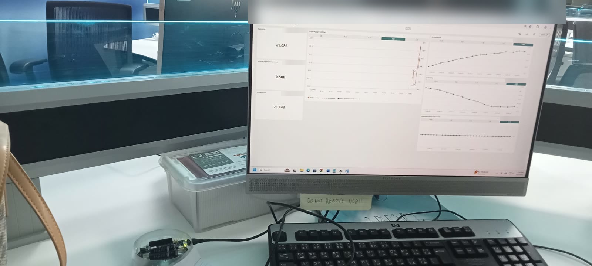
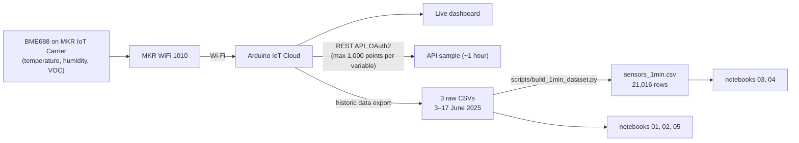
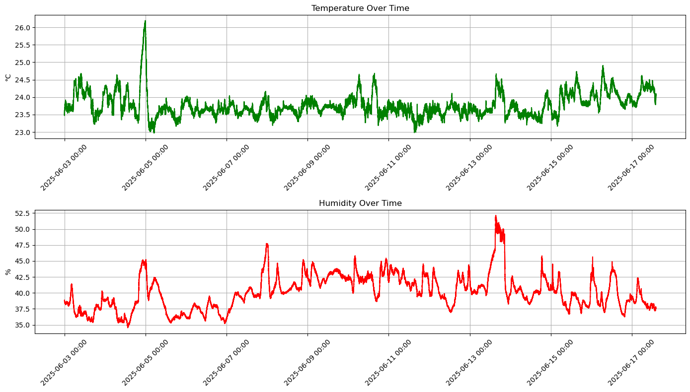
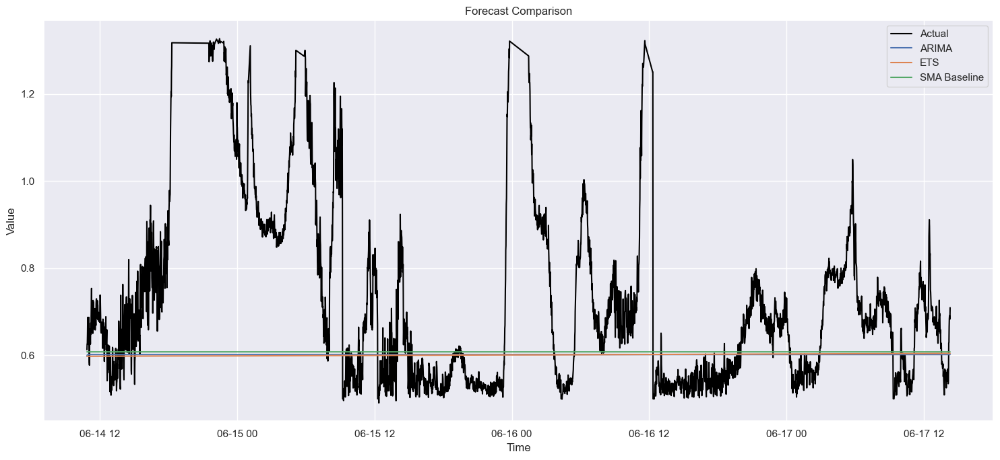

# IoT indoor air-quality forecasting

An Arduino indoor air-quality sensor and an honest look at forecasting its data.

## What we built

We set up an Arduino board with a sensor shield in a university lab, sent VOC, temperature and humidity readings to Arduino IoT Cloud, and watched them on a live dashboard. We then pulled the data out (first with a small Python API client, then with the cloud's bulk export) and tried a range of statistical and machine-learning models to forecast the readings.

Joint project with a classmate — DSAI3204 IoT Application Development, UDST, June 2025.

## Hardware and pipeline

Arduino MKR WiFi 1010 with an Arduino MKR IoT Carrier (sensor: Bosch BME688 on the Rev2 carrier, to be confirmed from the board marking). The board sends VOC every second and temperature/humidity whenever they change (about every 3.3 s). Details, the sketch, the API client and screenshots are in [`iot/README.md`](iot/README.md).





## Data

- 1.85 million raw readings from 3 June to 17 June 2025 (14.6 days, UTC): VOC about every 1 s, temperature and humidity about every 3.3 s.
- Rebuilt 1-minute dataset: [`data/sensors_1min.csv`](data/sensors_1min.csv), 21,016 rows, each sensor averaged per minute and joined on the timestamp.
- VOC is a sensor estimate in ppm-equivalent, not a calibrated concentration.
- Full description, units and known issues: [data card](data/README.md).



## What we tried

- Cleaning: timestamp parsing, 1-minute resampling, z-score outlier removal
- Exploration: time plots, rolling statistics, ADF stationarity test, ACF/PACF, seasonal decomposition
- Statistical models: ARIMA and auto-ARIMA, exponential smoothing (ETS), Prophet, a moving-average baseline
- Machine learning: linear, Ridge, Lasso and polynomial regression on time-of-day features; a Random Forest on 60 lagged VOC values; a Bayesian neural network in Pyro with uncertainty bands

| Notebook | What it does |
|---|---|
| [`01_data_exploration`](notebooks/01_data_exploration.ipynb) | EDA of the raw data; time-of-day regressions (no skill, kept for completeness) |
| [`02_voc_statistical_forecasting`](notebooks/02_voc_statistical_forecasting.ipynb) | ARIMA, ETS, Prophet and a moving-average baseline for VOC |
| [`03_arima_all_sensors`](notebooks/03_arima_all_sensors.ipynb) | auto-ARIMA for each sensor with a 100-minute backtest |
| [`04_voc_random_forest`](notebooks/04_voc_random_forest.ipynb) | Random Forest, next-minute VOC |
| [`05_bayesian_nn_uncertainty`](notebooks/05_bayesian_nn_uncertainty.ipynb) | Bayesian neural network (Pyro), next-minute humidity |

Each notebook starts with a short summary cell: data, split, horizon, result and caveats.

## Results compared with simple baselines

| Task | Model | Horizon | Model score | Simple baseline | Verdict |
|---|---|---|---|---|---|
| VOC, 1-minute data, chronological split | ARIMA / ETS / Prophet | whole test set (75 h) | RMSE 0.2115 / 0.2123 / 0.2271 | moving average 0.2085, train mean 0.2044 | none beat the baseline |
| VOC next minute | Random Forest (60 lags) | 1 min | R² 0.854 | repeat last value 0.824, mean of last 5 min 0.835 | small gain |
| Temperature / humidity / VOC | auto-ARIMA | 100 min | RMSE 0.264 / 0.302 / 0.044 | best simple baseline 0.198 / 0.299 / 0.036 | none beat the best baseline |
| Humidity next minute | Bayesian NN | 1 min | R² 0.9994 | repeat last value 0.9994 | tie (useful only for the uncertainty bands) |

The model scores are the saved outputs from our course notebooks. The baselines were computed later, during a review of the project, on the same data and splits. The ARIMA and Random Forest numbers come from an older intermediate file whose humidity column was misaligned (see the data card), so they will change when re-run on `sensors_1min.csv`.



In our course report we presented the Bayesian network (R² 0.9994) and the Random Forest as strong results. Comparing them with baselines showed that the first one only matches "repeat the last value" and the second one is only slightly better.

## What I learned

- **Check a naive baseline first.** At one-minute resolution the next value is almost the same as the current one, so a very high R² can mean nothing.
- **Split time series by time.** Shuffled train/test splits put neighbouring minutes in both sets and make results look better than they are.
- **Read the API limits.** Our client asked for 10 days but got about one hour, because the endpoint returns at most 1,000 points and we did not page through the results.
- **Align sensors by timestamp, not by row.** One of our intermediate files paired humidity with the wrong minutes, and we only found it later by comparing averages over the same time window.

## Limitations and next steps

Limitations:
- One room, 14.6 days, one uncalibrated sensor.
- Several course notebooks used shuffled splits or fit scalers before splitting.
- The forecast horizons were inconsistent: 1 minute, 100 minutes, and 75 hours.
- The Random Forest's 60-minute recursive forecast has a lag-order bug and was never scored.
- No seasonal (daily) model.

Next steps:
- Re-run notebooks 03 and 04 on the rebuilt dataset.
- Use time-series cross-validation with baselines everywhere.
- Report error against forecast horizon (1–60 minutes).
- Fix and score the recursive forecast.
- Try gradient boosting on lag features.
- Add pagination and token refresh to the API client.
- Add a VOC alert on the device.

## How to run

```bash
pip install -r requirements.txt
python scripts/build_1min_dataset.py
jupyter notebook notebooks/
```

The pinned versions (numpy < 2, scikit-learn < 1.6) match the code; Python 3.10 or 3.11 works best. The saved outputs in the notebooks are from our original runs. If packages will not install locally, open the notebooks in Google Colab after cloning the repo (`!git clone ...` then `%cd iot-indoor-air-quality-forecasting/notebooks`) so the relative `../data/` paths work.

The API client in `iot/api_client/` needs your own Arduino Cloud API key in a `.env` file (see `.env.example`).

## Repo structure

```
iot-indoor-air-quality-forecasting/
├── README.md
├── LICENSE
├── requirements.txt
├── iot/
│   ├── README.md
│   ├── firmware/         air_quality_node.ino, thingProperties.h, arduino_secrets.h.example
│   ├── api_client/       fetch_timeseries.py, .env.example
│   └── images/           device.jpg, setup.png, dashboard.png
├── data/
│   ├── README.md         data card
│   ├── raw/              humidity_raw.csv.gz, temperature_raw.csv.gz, voc_raw.csv.gz
│   ├── samples/          api_dump_sample.csv
│   └── sensors_1min.csv
├── scripts/
│   └── build_1min_dataset.py
├── notebooks/            01–05
└── figures/              plots exported from the notebooks
```

## Licence

Code: [MIT](LICENSE). Data (everything in `data/`): [CC BY 4.0](https://creativecommons.org/licenses/by/4.0/), see the [data card](data/README.md).
