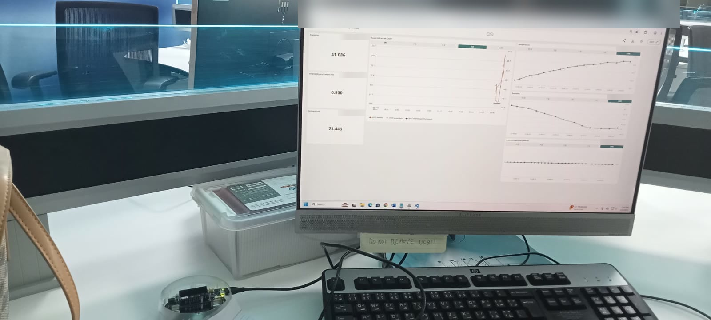
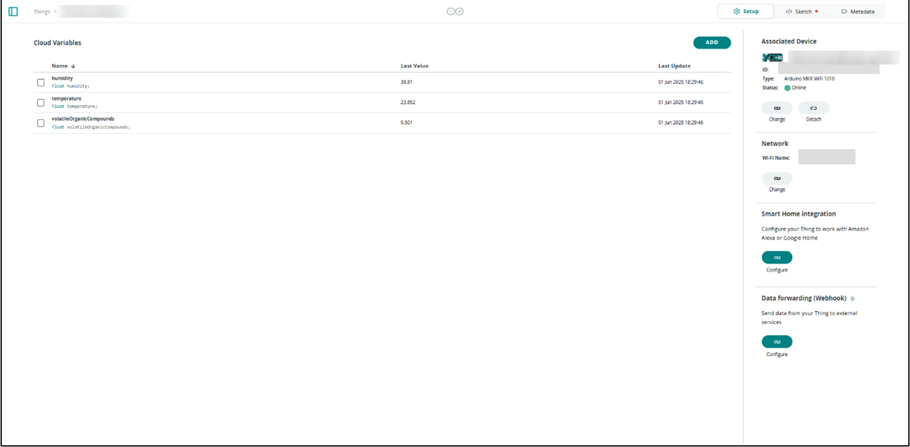
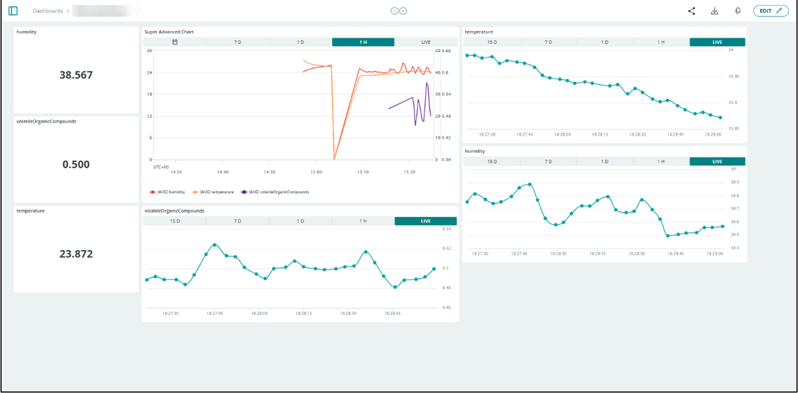
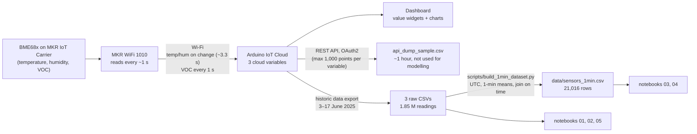

# IoT part: hardware, cloud and API client

This folder has everything from Part A of the project: the Arduino sketch, the Python client we used to pull data from Arduino IoT Cloud, and photos/screenshots of the setup. IDs, URLs and the Wi-Fi name are blurred or removed.

## Hardware

- **Board:** Arduino MKR WiFi 1010
- **Sensor shield:** Arduino MKR IoT Carrier, inside its plastic case (`CARRIER_CASE = true` in the sketch)
- **Sensor:** the readings come from the carrier, not the board (the MKR WiFi 1010 has no environmental sensors). The sketch calls `carrier.AirQuality.readVOC()`, which only exists for the Rev2 carrier, whose sensor is a **Bosch BME68x** gas sensor.
- **VOC value:** an estimate from Bosch's BSEC library, printed in "ppm". It is a breath-VOC equivalent, not a calibrated concentration.
- Powered over USB from a lab PC ("DO NOT REMOVE USB!!" note in the photo).

## Firmware (`firmware/`)

| File | What it is |
|---|---|
| `air_quality_node.ino` | The sketch. Generated by Arduino IoT Cloud; we added the carrier library, a "Waiting For Connection..." screen on the carrier display, and the three sensor reads in `loop()` (every ~1 s). The Thing name/URL lines were removed. |
| `thingProperties.h` | Generated by Arduino IoT Cloud: defines the cloud variables and the Wi-Fi connection. |
| `arduino_secrets.h.example` | Empty Wi-Fi SSID/password. Copy to `arduino_secrets.h` and fill in your own. |

### Cloud variables

| Variable | Type | Permission | Update policy | Effective rate in the data |
|---|---|---|---|---|
| `temperature` | float | read-only | on change | about every 3.3 s |
| `humidity` | float | read-only | on change | about every 3.3 s |
| `volatileOrganicCompounds` | float | read-only | every 1 s | about every 1.05 s |

Temperature and humidity change whenever the sensor updates, which is roughly every 3 s. VOC is sent every second but the sensor only updates about every 3 s, so about two out of three VOC values in the data are repeats of the previous one.

The sketch has no alerts, no watchdog and no local logging. Those were on our list of improvements.

## Dashboard and Thing setup (`images/`)

Both screenshots are from 1 June 2025, the day we set the device up.

## API client (`api_client/`)

`fetch_timeseries.py` is the client we used in Task 2, cleaned up so the credentials come from environment variables (see `.env.example`). It:

1. gets an access token with the OAuth2 client-credentials flow (API key = client ID + secret),
2. looks up the Thing and its variables (`ThingsV2Api`, `PropertiesV2Api`),
3. asks `SeriesV2Api` for the raw series of each variable, waiting 1 s between calls,
4. merges everything by timestamp into one wide CSV.

### The 1,000-point lesson

We asked for the last 10 days, but the raw series endpoint returns at most 1,000 points per variable and our client did not page through the results. So we only got the latest ~1 hour (about 56 minutes of humidity, 58 minutes of temperature and 19 minutes of VOC). You can see this in [`../data/samples/api_dump_sample.csv`](../data/samples/api_dump_sample.csv): exactly 1,000 values per column, with many blanks because the three sensors have different timestamps.

For the analysis we used Arduino Cloud's "download historic data" export instead (the assignment allowed this). The fix for the client would be to request the time range in smaller chunks and refresh the token, which only lasts about 5 minutes. This is described as a TODO in the script, not implemented.

## Pipeline

